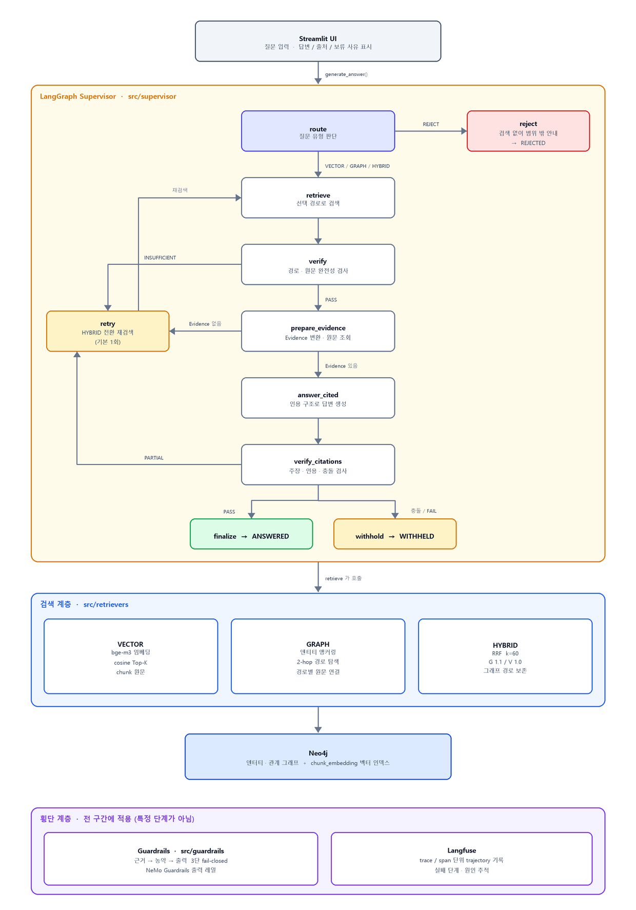

# 🌱 할루시네이션 방지 지식 검색 필터 — 식물 재배 GraphRAG

작물 재배 질문을 **벡터 검색 / 그래프 관계 추론 / 두 결과를 결합한 하이브리드 검색** 중 하나로 라우팅하고,
답변의 모든 주장을 **공식 농업 문서 원문과 대조**한 뒤, 근거가 부족하거나 충돌하면 **답변을 보류**하는
GraphRAG 질의응답 시스템입니다.

---

## 1. 프로젝트 소개

### 해결할 문제

작물 재배에 필요한 정보는 농촌진흥청 농사로, 국가농작물병해충관리시스템(NCPMS), 농약안전정보시스템(PSIS),
스마트팜코리아, 기상청 등 여러 기관에 흩어져 있습니다. 실제 재배 판단에는 작물·품종·지역·생육 단계·환경 조건·
병해충·관수·시비·등록 농약을 **함께** 고려해야 하므로, 단일 문서를 검색하는 것만으로는 답하기 어렵습니다.

> 예) "고추 탄저병 방제용으로 등록된 약제의 품목명은 무엇이며, 발병 후 언제부터 어떤 간격으로 최대 몇 회까지
> 사용할 수 있나요?" → `고추 → 탄저병 → 등록 농약 → 사용 조건` 관계를 따라가야 답이 나옵니다.

게다가 농약·비료 수치는 틀리면 실제 피해로 이어집니다. 그래서 이 시스템은 **답을 많이 만드는 쪽이 아니라,
근거를 확인하지 못한 답을 내보내지 않는 쪽**으로 설계했습니다.

### 목표

| 목표 | 구현 방식 |
|---|---|
| 질문 유형별 검색 경로 선택 | `QuestionRouter` 가 `VECTOR / GRAPH / HYBRID / REJECT` 판단 |
| Multi-hop 관계 추론 | Neo4j 2-hop 경로 탐색 + 경로별 원문 청크 연결 |
| 근거 검증 | 주장(claim) 단위 인용 검증 → 실패 시 재검색 → 그래도 실패하면 보류 |
| 안전 필터 | 농약 등록상태 fail-closed 검증 + NeMo Guardrails 출력 레일 |
| 멀티에이전트 | LangGraph Supervisor 가 검색·추론·검증 노드를 조정 |
| 품질 측정 | RAGAS(Faithfulness·Answer Relevancy 등) + ID 기반 Hit@K |

### 도메인과 데이터 출처

대상 작물은 **상추 · 양파 · 마늘 · 고추 · 배추** 5종입니다.

| 출처 | 기관 | 수집 방법 | 활용 |
|---|---|---|---|
| 농업기술길잡이 · 농작업일정 · 품종자료 | 농촌진흥청 농사로 | PDF 수집 → 텍스트 추출/OCR → 정제 → 청킹 | 재배·관수·시비 지식 |
| 병해 78종 · 해충 48종 상세정보 | 국가농작물병해충관리시스템(NCPMS) | OpenAPI → 작물·병해충명 정규화 → 발생생태·방제 필드 분리 | 병해충 지식 그래프 |
| 농약 사용정보 (원자료 5,134건 → 고유 5,130건) | 식품안전나라 · 농약안전정보시스템(PSIS) | OpenAPI → 등록·취소 이력 대조 → 작물·병해충 정확 일치 검증 | 등록 농약 검증·Guardrails |
| 비료 표준사용량 | 농촌진흥청 국립농업과학원 | CSV → 노지/시설 정규화 → 밑거름·웃거름 N·P·K 분리 | 조건별 시비 |
| 생육 관측 (PDF 81건 · CSV 14종) | 한국농촌경제연구원 농업관측센터 · 스마트팜코리아 | PDF 표 추출 · zip/CSV 구조화 | 생육 단계 지식 |
| 월별 기상 · 환경 관측 · 작물 환경조건 | 기상청 · FAO EcoCrop · 대학 Extension | CSV 정제 → 시군구별 월간 집계 | 지역·환경 추천 |

- 모두 **기관 공개자료**이며 출처 표시 조건을 지켜 사용합니다. OpenAPI 인증키는 저장소에 포함하지 않습니다.
- 개인정보는 없으며, 스마트팜 농가·시설 ID는 가명정보로 취급했습니다.
- 상세 명세: [데이터 명세서](#52-데이터-전처리-결과) 섹션 및 `data/processed/source_registry.jsonl`.

---

## 2. 주요 기능

### 2.1 질문 유형별 검색 경로 선택 (라우팅)

| 질문 유형 | 선택 경로 | 예시 |
|---|---|---|
| 단순 재배법·용어 질문 | `VECTOR` | "마늘 파종 시기는 언제인가요?" |
| 품종·환경·병해충 간 관계 질문 | `GRAPH` | "배수가 불량한 밭에서 늘어나는 병해는?" |
| 관계 + 세부 조건(농약 수치 등) 복합 질문 | `HYBRID` | "고추 탄저병 등록 약제의 사용 간격과 최대 횟수는?" |
| 농업 범위 밖 요청 | `REJECT` | "비트코인 가격을 예측해 주세요" |

라우터는 문항 ID나 정답셋을 보지 않고 질문 텍스트만으로 판단합니다. 전체 67문항 기준 **라우팅 정확도 62/67 (92.54%)**.

### 2.2 Multi-hop 관계 추론

Neo4j에서 시작 엔티티를 앵커링한 뒤 2-hop 경로를 탐색하고, **경로의 각 관계(edge)마다 원문 청크를 함께 반환**합니다.
원문 청크가 비어 있는 경로는 답변 근거로 쓰지 않습니다(`has_complete_evidence` 검사).

```
고추(Crop) ──AFFECTED_BY_DISEASE──▶ 탄저병(Disease) ──CONTROLS_TARGET──▶ 베노밀 수화제(PesticideUse)
   └ evidence: CHK_... (농사로 PDF)      └ evidence: CHK_... (NCPMS)      └ evidence: CHK_... (PSIS)
```

### 2.3 벡터 + 그래프 결합 (하이브리드)

Reciprocal Rank Fusion(RRF, k=60)으로 두 결과를 병합합니다. 가중치는 GRAPH 1.1 / VECTOR 1.0이며,
질문 어휘와 경로 노드·관계 표현의 일치도를 소폭(0.002) 가산합니다.
병합 과정에서 **그래프 경로가 사라지지 않도록** 같은 evidence/chunk가 겹쳐도 그래프 경로를 유지하고,
겹치는 벡터 원문은 `matched_vector_hits` 로 붙여 둡니다.

### 2.4 근거 검증과 응답 제한 (핵심 안전 장치)

```
검색 결과 → (1) 구조 검증 → (2) Evidence 변환 → (3) 인용 답변 생성 → (4) 주장별 인용 검증
                  ↓ 실패              ↓ 실패                                ↓ PARTIAL
              HYBRID 재검색 ◀───────────────────────────────────────────────────┘
                  ↓ 재시도 후에도 실패 / 근거 충돌
              응답 보류(WITHHELD) + 보류 사유 표시
```

최종 상태는 세 가지입니다.

- `ANSWERED` — 모든 주장이 인용 검증을 통과. 출처(문서 제목·ID·인용 구절)와 함께 표시.
- `WITHHELD` — 근거 부족 또는 근거 간 충돌. **사유를 코드와 함께 표시**(`NOT_SUPPORTED`, `CONFLICT [...]` 등).
- `REJECTED` — 농업 범위 밖 질문. 검색을 아예 실행하지 않음.

### 2.5 안전 필터 (농약 · 비료)

3단 fail-closed 파이프라인 `validate_evidence → validate_pesticide → validate_output` 을 순서대로 통과해야 합니다.

- **evidence**: 근거의 source가 `graph|vector` 인지, ID 형식과 본문이 유효한지 검사.
- **pesticide**: 등록상태가 `VERIFIED_CURRENT` 가 아니면(`UNKNOWN`, `PRELIMINARY_PASS`, `REVIEW_REQUIRED`,
  `EXPIRED`, `REJECTED`) 차단 또는 경고. 상태 표기가 없으면 `UNKNOWN` 으로 간주합니다(= 모르면 막습니다).
- **output**: 답변의 숫자 토큰이 근거에 실제로 있는지 검사하고, 의미 대조는 LLM-as-Judge로 판정.
  판정 불가·API 키 없음 등은 모두 `FALLBACK` 입니다.

NeMo Guardrails(Colang 1.0) 출력 레일 `validate graph rag output` 이 이 파이프라인을 액션으로 호출합니다.

### 2.6 Streamlit UI

| 메뉴 | 내용 |
|---|---|
| 💬 물어보기 | Supervisor 챗봇. 답변 또는 보류 사유 + 출처 표시 |
| 🌿 작물 도감 | 작물별 품종·생육 환경·병해충 |
| 🐛 병해충 도감 | 증상·발생생태·예방법, 등록 약제로 이동 |
| 🧪 농약 조회 | 작물·병해충별 등록 약제, 희석배수·안전사용기준(⚠️ 재확인 필요 표시) |
| 🗺️ 지역 정보 | 2024~2025 월별 기온·강수량, 품종별 권장 지역 |

---

## 3. 기술 스택

| 영역 | 사용 기술 | 선택 이유 |
|---|---|---|
| 그래프 DB | **Neo4j 6.2** + Cypher | 엔터티·관계 2-hop 탐색과 관계별 근거 연결을 한 쿼리로 처리 |
| 벡터 인덱스 | **Neo4j Vector Index** (`chunk_embedding`, cosine, 1024차원) | 그래프와 벡터를 한 DB에 둬 경로-원문 연결이 끊기지 않음 |
| 임베딩 | **BAAI/bge-m3** (sentence-transformers) | 한국어 농업 문서 성능, 로컬 실행으로 API 비용 없음 |
| 리랭커 (오프라인) | Cross-Encoder (`sentence-transformers`), FlagEmbedding | VECTOR Hit@10 개선 실험용 — **서비스 검색기에는 미적용** |
| 오케스트레이션 | **LangGraph 1.x** (Supervisor 패턴) | 조건부 엣지로 재검색·보류·거절 분기를 명시적으로 표현 |
| LLM | **OpenAI API** (`langchain-openai`, `openai` 2.x) | 인용 답변 생성, 주장 지원 판정, 출력 검증 Judge |
| 가드레일 | **NeMo Guardrails 0.23** (Colang 1.0) + 자체 validator | 선언적 출력 레일 + 결정적(deterministic) 농약 검증 결합 |
| 평가 | **RAGAS 0.4.3**, 자체 ID 기반 Hit@K / Multi-hop 채점 | 생성 품질(RAGAS)과 검색 품질(ID 일치)을 분리 측정 |
| 추적 | **Langfuse 4.14** | trace/span 단위 trajectory 기록과 실패 단계 확인 |
| UI | **Streamlit 1.59** | 검색 경로·근거·보류 사유를 한 화면에서 시연 |
| 패키지 관리 | **uv** (Python 3.12) | `uv.lock` 으로 팀 환경 재현 |

---

## 4. 실행 방법

### 4.1 실행 요구사항

- **Python 3.12** (`.python-version` 고정)
- **[uv](https://docs.astral.sh/uv/)** 패키지 매니저
- **Neo4j 5.x 이상** (로컬 또는 Aura). Vector Index 기능이 필요합니다.
- **OpenAI API 키** — 답변 생성·인용 검증·RAGAS 평가에 사용
- 디스크 여유 공간 약 **10GB** (torch · bge-m3 · reranker 모델 캐시 포함)
- 첫 실행 시 bge-m3 임베딩 모델(약 2.3GB)을 Hugging Face에서 내려받습니다.
- CPU만으로도 동작하지만, 리랭커 오프라인 실험은 문항당 20초대가 걸립니다(§5.5 참고).

### 4.2 의존성 설치

```bash
git clone https://github.com/encore-ai-campus/mle-01-p3-team2.git
```

```bash
cd mle-01-p3-team2
```

```bash
uv sync
```

`uv sync` 가 `.venv` 를 만들고 `uv.lock` 의 고정 버전을 그대로 설치합니다.
이후 명령은 `uv run <명령>` 또는 `.venv/Scripts/python.exe`(Windows) / `.venv/bin/python`(macOS·Linux)로 실행합니다.

### 4.3 환경 변수 설정

`.env.example` 을 복사해 `.env` 를 만들고 값을 채웁니다. (`.env` 는 `.gitignore` 에 있어 커밋되지 않습니다.)

```bash
cp .env.example .env
```

| 변수 | 필수 | 기본값 | 설명 |
|---|:--:|---|---|
| `NEO4J_URI` | ✅ | — | 예: `bolt://localhost:7687`, `neo4j+s://xxxx.databases.neo4j.io` |
| `NEO4J_PASSWORD` | ✅ | — | Neo4j 비밀번호 |
| `NEO4J_USERNAME` | | `neo4j` | 검색기·Supervisor가 읽는 사용자명 |
| `NEO4J_USER` | | — | **인덱싱 스크립트(`build_vector_index.py`)에서만** 요구하는 이름. `NEO4J_USERNAME` 과 같은 값을 넣어 두세요 |
| `NEO4J_DATABASE` | | `neo4j` | 사용할 데이터베이스 이름 |
| `OPENAI_API_KEY` | ✅ | — | 답변 생성·인용 검증·출력 검증·RAGAS |
| `OPENAI_CHAT_MODEL` | | 코드 기본값 | 답변 생성에 쓸 채팅 모델 |
| `OPENAI_EVAL_MODEL` | | `gpt-4.1` | RAGAS 평가용 모델 |
| `GUARDRAIL_JUDGE_MODEL` | | `gpt-4o-mini` | 출력 검증 LLM-as-Judge 모델 |
| `LANGFUSE_PUBLIC_KEY` | ⬜ | — | trajectory 수집 시 필요 |
| `LANGFUSE_SECRET_KEY` | ⬜ | — | trajectory 수집 시 필요 |
| `LANGFUSE_HOST` | ⬜ | `https://cloud.langfuse.com` | 셀프호스팅 시 변경 |

✅ 필수 · ⬜ Langfuse trajectory 수집에만 필요

`.env` 예시:

```dotenv
NEO4J_URI=bolt://localhost:7687
NEO4J_USERNAME=neo4j
NEO4J_USER=neo4j
NEO4J_PASSWORD=change-me
NEO4J_DATABASE=neo4j

OPENAI_API_KEY=sk-...
OPENAI_CHAT_MODEL=gpt-4.1-mini
OPENAI_EVAL_MODEL=gpt-4.1
GUARDRAIL_JUDGE_MODEL=gpt-4o-mini

LANGFUSE_PUBLIC_KEY=pk-lf-...
LANGFUSE_SECRET_KEY=sk-lf-...
LANGFUSE_HOST=https://cloud.langfuse.com
```

### 4.4 인덱싱 (처음 한 번)

`data/processed/` 의 전처리 산출물을 Neo4j에 올립니다. 모든 스크립트는 **ID 기준 멱등(idempotent)** 이라
다시 실행해도 중복이 생기지 않습니다.

**① 그래프 적재** — 엔터티 30,933건 / 관계 46,034건

```bash
uv run python -m scripts.indexing.load_neo4j
```

**② 청크 메타데이터 적재** — chunk_id · source_id · 원문 텍스트 · 출처 URL

```bash
uv run python -m scripts.indexing.build_vector_index neo4j-metadata
```

**③ 임베딩 + 벡터 인덱스 생성** — `chunk_embedding` (cosine, 1024차원). 30,661 청크라 시간이 오래 걸립니다.

```bash
uv run python -m scripts.indexing.build_vector_index neo4j-build
```

중단된 경우 이미 저장된 청크를 건너뛰고 이어서 올릴 수 있습니다.

```bash
uv run python -m scripts.indexing.build_vector_index neo4j-store --resume
```

**④ 적재 확인** — Neo4j Browser에서 `scripts/verify_graph.cypher` 를 실행하거나:

```bash
uv run python -m scripts.evaluation.evaluate_retrieval --check-neo4j
```

### 4.5 평가 실행

```bash
uv run python -m scripts.evaluation.evaluate_routing
```

```bash
uv run python -m scripts.evaluation.evaluate_retrieval --collect
```

```bash
uv run python -m scripts.evaluation.evaluate_multihop --observer supervisor --k 10
```

```bash
uv run python -m scripts.evaluation.evaluate_integrated_ragas --top-k 5
```

```bash
uv run python -m scripts.evaluation.golden_trajectory
```

골든셋 무결성 검사와 전체 테스트:

```bash
uv run python -m scripts.evaluation.check_golden_set
```

```bash
uv run python -m pytest tests -q
```

> 결과는 `data/evaluation/` 및 `data/evaluation/reports/` 에 JSONL·JSON·CSV로 저장됩니다.
> Neo4j가 필요한 평가는 로컬 셸에서 직접 실행하는 것을 권장합니다
> (연결 오류 사례는 [VECTOR 검색 최적화 리포트](docs/vector-search-optimization-report.md) 2.1 참고).

### 4.6 UI 사용법

1. 배포된 Streamlit 앱 주소를 엽니다.
2. 상단 메뉴에서 **물어보기 / 작물 도감 / 병해충 도감 / 농약 조회 / 지역 정보** 를 고릅니다.
3. **물어보기** 화면 아래 입력창에 질문을 적거나, 사이드바의 예시 질문 버튼을 누릅니다.
4. 답변 말풍선에서 확인할 내용:
   - **답변 본문** — 주장마다 인용 번호가 붙습니다.
   - **출처** — 문서 제목 · `evidence_id` / `chunk_id` · 인용 구절. 그래프 경로 질문은 거쳐 간 관계 경로도 함께 표시됩니다.
   - **보류 안내** — 근거가 부족하거나 충돌하면 답변 대신 "답변을 보류합니다" 와 사유 코드가 나옵니다.
   - **거절 안내** — 농업 범위 밖 질문은 "농업 재배·병해충·농약·비료 관련 질문을 입력해 주세요" 로 안내합니다.
5. 사이드바 **🧹 대화 초기화** 로 대화를 비웁니다.
6. 농약 화면의 **⚠️** 표시는 등록상태를 재확인해야 하는 건입니다. 실제 사용 전 공식 조회가 필요합니다.

---

## 5. 폴더 구조

```
mle-01-p3-team2/
├── README.md                     # 최종 발표 자료 (이 문서)
├── pyproject.toml / uv.lock      # 의존성 고정
├── .python-version               # 3.12
├── .env                          # 환경 변수 (커밋하지 않음)
│
├── src/
│   ├── retrievers/               # 검색 계층
│   │   ├── router.py             #   질문 유형 → VECTOR/GRAPH/HYBRID/REJECT 판단
│   │   ├── vector_retriever.py   #   Neo4j chunk_embedding 벡터 검색
│   │   ├── graph_retriever.py    #   엔티티 앵커링 + 2-hop 경로 탐색 + 경로 랭킹
│   │   ├── hybrid_retriever.py   #   RRF 병합, 그래프 경로 보존
│   │   ├── execution.py          #   세 경로를 한 인터페이스로 실행 (연결 오류 처리 포함)
│   │   ├── search_result.py      #   SearchResult / GraphPathEdge / OriginalChunk 공통 계약
│   │   └── answer/               #   Evidence 변환·원문 조회·인용 답변 렌더링
│   │
│   ├── supervisor/               # LangGraph Supervisor
│   │   ├── graph.py              #   route→retrieve→verify→answer→verify_citations→finalize/retry/withhold
│   │   ├── state.py              #   GraphState (노드 간 공유 상태)
│   │   ├── answer_agent.py       #   인용 답변 생성 + 주장 지원 판정
│   │   └── citation_verifier.py  #   주장·인용·충돌 검증
│   │
│   ├── guardrails/               # 안전 계층
│   │   ├── contracts.py          #   GuardrailRequest / ValidationResult
│   │   ├── evidence_validator.py #   근거 형식·ID 검증
│   │   ├── pesticide_validator.py#   농약 등록상태 fail-closed 검증
│   │   ├── output_validator.py   #   숫자 토큰 대조 + LLM-as-Judge
│   │   ├── pipeline.py           #   3단 순차 실행
│   │   └── nemo/                 #   NeMo Guardrails (config.yml · rails.co · actions.py)
│   │
│   └── streamlit/                # UI
│       ├── app.py                #   엔트리포인트, 메뉴·챗 화면
│       ├── chatbot.py            #   UI ↔ Supervisor 경계
│       ├── crop_page.py / pest_page.py / pesticide_page.py / region_page.py
│       ├── *_data.py             #   화면별 Neo4j 조회·가공
│       └── theme.py / static/    #   테마·폰트·마스코트
│
├── scripts/
│   ├── run_supervisor.py         # 질문 1건 CLI 실행 (Streamlit도 build_app() 재사용)
│   ├── indexing/
│   │   ├── load_neo4j.py         #   엔터티·관계 적재
│   │   └── build_vector_index.py #   청크 메타데이터·임베딩·벡터 인덱스
│   ├── evaluation/               # 평가·진단 (라우팅·검색·multi-hop·RAGAS·trajectory·골든셋 검사)
│   └── maintenance/
│       └── vector_portability.py #   인덱스 이식성 점검
│
├── data/
│   ├── processed/                # 전처리 산출물 (인덱싱 입력)
│   │   ├── entities.jsonl (30,933) / relations.jsonl (46,034)
│   │   ├── evidence.jsonl (30,650) / chunks.jsonl (30,661)
│   │   └── documents.jsonl (146) / source_registry.jsonl (146)
│   └── evaluation/
│       ├── golden_set_final.jsonl         # 평가 질문 67문항
│       ├── golden_trajectory_results.jsonl# Langfuse trace 요약
│       ├── rag_eval_*_v2.*                # RAGAS v2 결과·요약
│       ├── integrated_ragas/              # 통합 파이프라인 RAGAS 결과
│       └── team_candidates/               # 문항 후보·검수 원본
│
├── docs/
│   ├── multihop-retrieval-report.md          # GRAPH·HYBRID Multi-hop 개선 상세 리포트
│   └── vector-search-optimization-report.md   # VECTOR 검색 진단·리랭커 실험 리포트
│
├── notebooks/                    # 평가셋 생성·병합·RAG 평가 노트북
├── tranjectory/Trajectory.ipynb  # Langfuse trajectory 계측 설계·실행
└── tests/                        # pytest (라우터·검색기·Supervisor·가드레일·평가 스크립트)
```

---

## 6. 아키텍처 개요

### 6.1 전체 흐름



### 6.2 에이전트(노드) 역할과 분기 조건

| 노드 | 역할 | 다음 단계 조건 |
|---|---|---|
| `route` | 질문 유형 판단, 작물·hop 수 추출 | `REJECT` → `reject`, 그 외 → `retrieve` |
| `retrieve` | 선택 경로로 검색, 시도 이력 누적 | 항상 → `verify` |
| `verify` | 경로·원문 청크 완전성 검사 | `PASS` → `prepare_evidence` / 부족 → `retry`(여유 있으면) 또는 `withhold` |
| `prepare_evidence` | SearchResult → 공통 Evidence 변환, 원문 조회 | Evidence 있으면 → `answer_cited`, 없으면 → `retry`/`withhold` |
| `answer_cited` | 인용 구조(claim + citation)로 답변 생성 | 항상 → `verify_citations` |
| `verify_citations` | ID·인용문·주장 지원 여부 검사, 충돌 탐지 | `PASS` → `finalize` / `PARTIAL` → `retry` / 충돌·`FAIL` → `withhold` |
| `retry` | **HYBRID로 경로 전환**, 실패한 주장을 질의에 추가해 재검색 (기본 1회) | → `retrieve` |
| `finalize` | 실제 출처 정보를 붙여 최종 답변 렌더링 | → END (`ANSWERED`) |
| `withhold` | 충돌·인용 실패·원문 조회 실패 사유를 모아 보류 | → END (`WITHHELD`) |
| `reject` | 검색 없이 범위 밖 안내 | → END (`REJECTED`) |

**설계 의도** — 검색(`retrieve`)·추론(`answer_cited`)·검증(`verify`, `verify_citations`)을 분리했기 때문에
`route_path`(예: `["GRAPH", "HYBRID"]`)와 `attemps` 기록만 보면 **어느 단계에서 실패했는지** 바로 알 수 있습니다.
또 `retrieved_results`(검증 전 원본)와 `results`(검증 통과분)를 따로 보관해,
**검색이 못 찾은 것**과 **찾았지만 근거가 불완전해 버린 것**을 구분해 측정합니다.

### 6.3 데이터 모델

- **엔터티 16종** — `Crop`(5) · `Variety`(61) · `VarietyGroup`(14) · `Region`(265) · `Disease`(78) ·
  `Insect`(48) · `PesticideUse`(5,130) · `FertilizerStandard`(9) · `ManagementFact`(5,938) ·
  `EnvironmentFact`(97) · `GrowthObservation`(7,132) · `EnvironmentObservation`(6,525) ·
  `WeatherObservation`(5,591) · `SowingObservation`(9) · `SowingRecommendation`(7) · `TimePeriod`(24)
- **관계 18종** — `AFFECTED_BY_DISEASE` · `AFFECTED_BY_INSECT` · `CONTROLS_TARGET`(3,181) ·
  `HAS_REGISTERED_PESTICIDE_USE`(5,130) · `HAS_FERTILIZER_STANDARD` · `HAS_VARIETY` ·
  `SUITABLE_FOR_REGION` · `HAS_ENVIRONMENT_REQUIREMENT` · `HAS_MANAGEMENT_FACT` 등
- **근거 체인** — 모든 엔터티·관계가 `evidence_ids` → `chunk_ids` → `document_id` → `source_url` 로
  원문까지 추적됩니다. 답변의 출처를 열면 실제 문서와 인용 구절을 확인할 수 있습니다.
- **식별 키** — `entity_id` · `relation_id` · `evidence_id` · `chunk_id` · `document_id` · `source_id`.
  필수 ID·참조 결측 0건, ID 중복 0건.

---

## 7. 상세 산출물

- 📄 [GraphRAG Multi-hop 검색 초기 이슈 및 최종 개선 결과](docs/multihop-retrieval-report.md)
- 📄 [VECTOR 검색 초기 이슈 및 최적화 결과](docs/vector-search-optimization-report.md)
- 📊 RAGAS 실행 원본(검색 개선 **반영 전** 측정, 성능 수치로 인용하지 않음):
  `data/evaluation/integrated_ragas/` · `data/evaluation/rag_eval_results_v2.jsonl`
- 🔍 Langfuse trajectory 원본: `data/evaluation/golden_trajectory_results.jsonl` · `tranjectory/Trajectory.ipynb`
- ✅ 평가셋: `data/evaluation/golden_set_final.jsonl` (검수 원본 `data/evaluation/team_candidates/`)

---

## 8. 팀원 소개

> 🚧 추후 작성 예정

| 이름 | 역할 | 담당 영역 | GitHub |
|---|---|---|---|
| 백관민 | | | |
| 조자룡 | | | |
| 김유건 | | | |
| 현유진 | | | |
| 김수민 | 팀장 | | |

---

## 라이선스 및 데이터 이용 조건

- 사용한 농업 데이터는 모두 공공기관 공개자료이며, 기관별 이용 조건과 출처 표시 의무를 따릅니다.
- OpenAPI 인증키 및 `.env` 는 저장소에 포함하지 않습니다.
- **이 시스템의 답변은 공식 자료 검색 결과이며, 농약·비료의 실제 사용 전에는 반드시 제품 라벨과
  최신 등록사항(PSIS·식품안전나라)을 직접 확인해야 합니다.**
